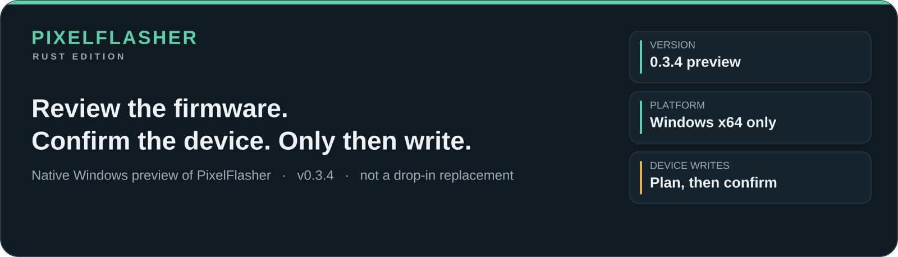
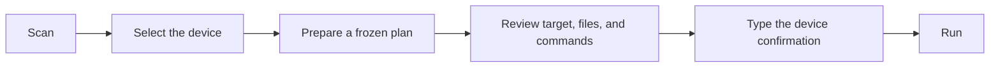
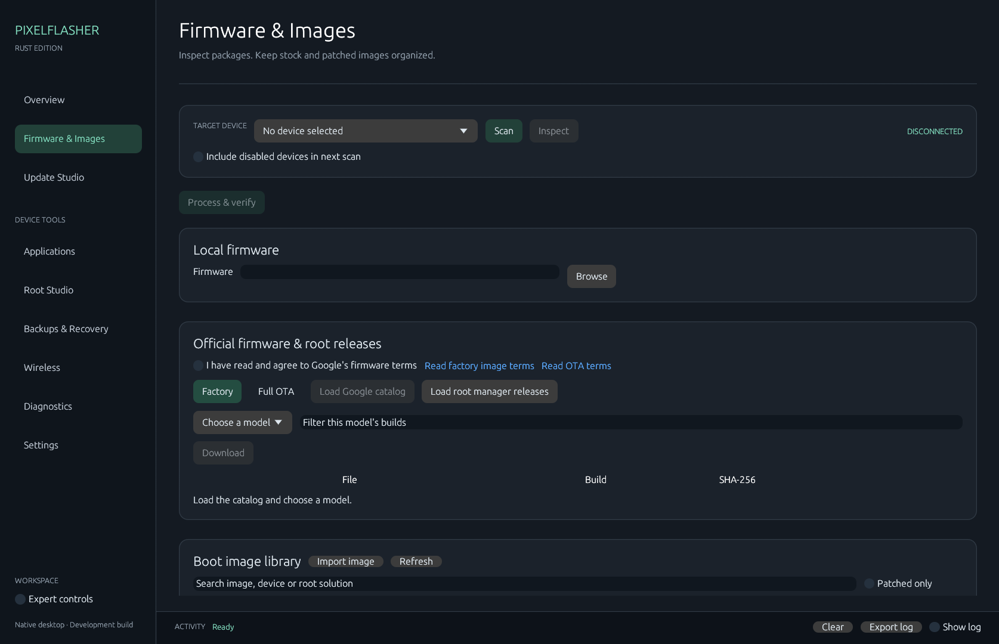
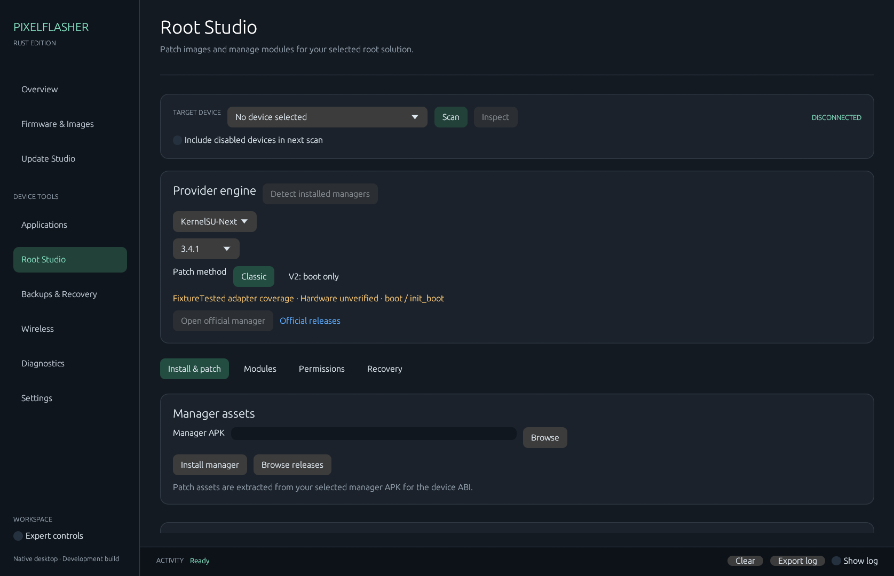

<div align="center">



<p>
  <a href="https://www.gnu.org/licenses/agpl-3.0"></a>
  <a href="https://github.com/contactjayclatty/PixelFlasher-Rust-Edition/actions/workflows/ci.yml"></a>
  <a href="https://github.com/contactjayclatty/PixelFlasher-Rust-Edition/releases"></a>
  <a href="https://www.rust-lang.org/"></a>
</p>

</div>

> [!WARNING]
> **Not hardware-validated.** Independent Rust port of [PixelFlasher](https://github.com/badabing2005/PixelFlasher), pinned to upstream `081286d6baf8ac969df29e8b0ab3a5b6ae4cfb54` (10.1.1.1). Tests cover parsers, planners, and selected workflows. They do not prove that flashing, rooting, unlocking, wiping, or restore works on a real phone. Read [parity](docs/PARITY.md) and [validation](docs/VALIDATION.md) before you use a device.

## On this page

| | | |
|---|---|---|
| [Start here](#start-here) | [Workspaces](#workspaces) | [What 0.3.4 covers](#coverage) |
| [Install](#install) | [First session](#first-session) | [Safety](#safety) |
| [Command line](#command-line) | [Build](#build) | [When something looks wrong](#trouble) |
| [Upstream and license](#license) | [Documentation](#documentation) | [Get help](#get-help) |

<a name="start-here"></a>


| You want | Use |
|---|---|
| The maintained, full application | [Upstream PixelFlasher](https://github.com/badabing2005/PixelFlasher) |
| This native Rust preview, knowing every device write is still unproven | This repository, **Windows x64** |
| macOS, Linux, translations, or complete upstream behavior | Not this release |

Rust Edition does not launch or embed the Python app. It does not scan or talk to a phone until you press **Scan**. A device-changing action stays a frozen plan until you review the target, files, and commands, then type that device's confirmation.

<a name="workspaces"></a>


One device bar (selected device, **Scan**, **Inspect**) and nine workspaces.

| Workspace | What you do there |
|---|---|
| **Overview** | Readiness, plus status for the device, images, and platform-tools |
| **Update Studio** | Prepare factory, Full OTA, standalone-image, and live-boot plans |
| **Root Studio** | Prepare Magisk, KernelSU, KernelSU-Next, SukiSU, Wild_KSU, and APatch workflows |
| **Firmware & Images** | Library, Google Factory catalog, Google Full OTA catalog |
| **Applications** | Browse packages and prepare supported package actions |
| **Backups & Recovery** | Partition backups and checksum-bound restore plans |
| **Diagnostics** | Properties, slots, log snapshots, and a subset of integrity checks |
| **Settings** | Platform-tools folder, data location, optional local MCP |
| **Wireless** | Pair, connect, and disconnect wireless debugging |



Stopping the run cannot undo a write that already finished. A command that returned is not proof the phone will boot.

<a name="coverage"></a>


**In the app** means the Rust path exists and is wired up. It does not mean a phone was used. Every device-mutation row below is hardware-unverified.

| Area | 0.3.4 | The limit that matters |
|---|---|---|
| Device discovery, labels, properties, slots | In the app | Development did not include a live-device scan |
| Platform-tools check | In the app | Still warns on platform-tools 34.0.0 through 34.0.4 |
| Boot-image library and checksums | In the app | Legacy database import is read-only, and only when the recorded SHA-1 still matches the file |
| Factory ZIP and Full OTA payload | In the app | Incremental OTAs are rejected. Samsung Odin/AP handling is not equivalent to upstream |
| Factory flash, image flash, OTA sideload, live boot | Planned in the app | Live boot accepts boot images only. Nothing here has been flashed on hardware |
| Root providers and modules | Partial | Six adapters check APK identity and version. Their scripts are unverified. Unpinned or canary builds are rejected |
| GKI kernel replacement | Manual plan only | You pick the kernel. There is no automatic KMI-compatible download |
| Packages, logcat snapshot, scrcpy, Shizuku | In the app | Command plans only. They were not run against a phone |
| Partition backup and restore planning | In the app | A match checks device, build, slot, and content. That does not prove the restore will boot |
| Google Factory and Full OTA catalogs | Stable only | Requires an explicit acknowledgement of Google's terms. Beta, canary, and watch catalogs are absent |
| Local MCP | Optional, off by default | Reads saved metadata and can queue a desktop review. It cannot run a device operation, a shell, or read secrets |

Not in this release: macOS and Linux packages, upstream's 23 translations, AVB downgrade and no-wipe downgrade, the automated integrity checker, APatch's alternate patch path, and legacy special Magisk recovery builds.

The line-by-line matrix is [docs/PARITY.md](docs/PARITY.md). This release is not 1.0. The roadmap is [docs/IMPLEMENTATION.md](docs/IMPLEMENTATION.md).

## A look around

| Firmware & Images | Root Studio |
|---|---|
|  |  |
| Pick a catalog and a model, select one build row, then Download. | Pick a provider and prepare only the workflow that provider supports. |

<a name="install"></a>


Published builds are **Windows x64** only.

1. From [Releases](https://github.com/contactjayclatty/PixelFlasher-Rust-Edition/releases), download the latest Windows ZIP and `checksums.sha256`.
2. Check the ZIP's SHA-256 against the matching line in `checksums.sha256`.
3. Extract the ZIP and launch `PixelFlasher.exe`.
4. Install Android [platform-tools](https://developer.android.com/tools/releases/platform-tools). In **Settings**, select the folder that contains both `adb.exe` and `fastboot.exe`.

The ZIP does not include platform-tools, scrcpy, or the original Python application.

Settings and the image library default to:

```text
%LOCALAPPDATA%\PixelFlasherRust
```

Set `PIXELFLASHER_DATA_DIR` before launch to use another directory. That selects a different workspace. It does not copy the old one.

<a name="first-session"></a>


1. Start the app. It does not look for a device on its own.
2. In **Settings**, select the platform-tools folder. The app checks for both ADB and fastboot.
3. Connect the phone in the mode the task needs, press **Scan**, then select that device before you inspect or prepare anything.
4. In **Firmware & Images**, add a supported file or open a Factory / Full OTA catalog. Catalog access requires you to acknowledge Google's terms.
5. Read the plan. Check the device, input files, commands, and choices such as wipe or slot. Destructive work asks for a typed confirmation for that device.
6. Do not continue unless you understand the operation and have a way to recover the phone.

The confirmation is a safeguard, not a guarantee of authenticity, compatibility, anti-rollback safety, or a successful boot. Interrupted operations are kept for inspection and are not replayed.

<a name="safety"></a>


Flashing, bootloader unlock or lock, root changes, partition writes, and restores can erase data or leave a device unable to boot.

Before a run, the app freezes the plan (target plus the hashes of the inputs that matter) and rechecks those inputs. That recheck does not make an image trustworthy. Development does not flash, root, unlock, relock, wipe, pair wirelessly, or restore anything on hardware.

Details: [validation gaps](docs/VALIDATION.md) and [how plans are bounded](docs/ARCHITECTURE.md).

<a name="command-line"></a>


These commands inspect files and catalogs. They do not flash, and they do not replace the reviewed desktop flow for device writes.

```powershell
.\PixelFlasher.exe --inspect .\images\init_boot.img
.\PixelFlasher.exe --process .\firmware\factory-image.zip
.\PixelFlasher.exe --library
.\PixelFlasher.exe --import-legacy .\PixelFlasher4.db
.\PixelFlasher.exe --catalog factory --acknowledge-google-terms
.\PixelFlasher.exe --catalog ota --acknowledge-google-terms
```

| Flag | It does | It does not |
|---|---|---|
| `--inspect` | Read image metadata | Flash the image |
| `--process` | Process a supported firmware archive | Accept an incremental OTA |
| `--library` | Show the local Rust Edition library | Talk to a device |
| `--import-legacy` | Import a legacy BOOT database, read-only | Modify the source database |
| `--catalog` | Fetch stable Factory or Full OTA metadata after you acknowledge Google's terms | Download firmware, or contact a device |

Optional local MCP is documented in [docs/MCP.md](docs/MCP.md). Leave it off unless you want a local agent to read saved metadata.

<a name="build"></a>


Install Rust and the native dependencies eframe needs, then:

```powershell
git clone https://github.com/contactjayclatty/PixelFlasher-Rust-Edition.git
cd PixelFlasher-Rust-Edition
cargo run -j 2
```

Checks and a release build:

```powershell
cargo fmt --all --check
cargo test --locked --workspace -j 2
cargo clippy --locked --workspace --all-targets -j 2 -- -D warnings
cargo build --locked --workspace --release -j 2
```

Windows CI is not evidence that a device operation works. To capture the UI while developing:

```powershell
$env:EFRAME_SCREENSHOT_TO = "screenshot.png"
$env:PIXELFLASHER_CAPTURE_PAGE = "firmware" # overview, root, apps, backups
cargo run --release
```

Packaging rules are in [docs/RELEASING.md](docs/RELEASING.md). Contributor layout is in [CONTRIBUTING.md](CONTRIBUTING.md).

## Repository

| Path | What lives there |
|---|---|
| [`crates/core`](crates/core) | Firmware, flash plans, devices, root providers, library, recovery |
| [`src`](src) | Desktop UI and the compatibility facade |
| [`crates/mcp`](crates/mcp) | Optional stdio MCP executable |
| [`docs`](docs) | Parity, architecture, validation, release rules, and these header images |
| [`tests`](tests) | Parser, planner, catalog, and studio fixtures |

<a name="documentation"></a>

## Documentation

| Document | Read it for |
|---|---|
| [Feature parity](docs/PARITY.md) | Implemented, partial, unverified, and missing upstream areas |
| [Architecture](docs/ARCHITECTURE.md) | Core and UI boundaries, plans, and what is allowed to run |
| [Implementation plan](docs/IMPLEMENTATION.md) | Roadmap and the gates for 1.0 |
| [Validation](docs/VALIDATION.md) | Automated evidence, UI captures, and untested workflows |
| [MCP](docs/MCP.md) | The local agent contract and what it cannot do |
| [Contributing](CONTRIBUTING.md) | Layout and the checks a change should pass |
| [Releasing](docs/RELEASING.md) | How a Windows package is cut |
| [Changelog](CHANGELOG.md) | What changed in 0.3.0 through 0.3.4 |
| [Notice](NOTICE.md) | Upstream attribution and the license record |

<a name="trouble"></a>


| What you see | What to check |
|---|---|
| **Scan** finds nothing | **Settings** points at a folder with both `adb.exe` and `fastboot.exe`. The app does not scan at startup. The phone has to already be in the mode that task needs. |
| The catalog stays empty | You have not acknowledged Google's terms, or you expected a beta, canary, or watch catalog. Those are not in 0.3.4. |
| A file or root package is refused | Incremental OTAs are rejected. Live boot accepts boot images only. Root adapters reject package versions they do not pin. |
| Settings or images vanished | Data is per directory: `%LOCALAPPDATA%\PixelFlasherRust`, or whatever `PIXELFLASHER_DATA_DIR` was at launch. A different path is a different library. |
| You expected the Python app | This build never starts it. Behavior will not match [upstream](https://github.com/badabing2005/PixelFlasher) feature for feature. See [parity](docs/PARITY.md). |

<a name="license"></a>


Upstream PixelFlasher is a Python/wxPython application. Rust Edition is a separate port with a native interface and a different safety model: frozen plans, a recheck before run, and no automatic replay. Publication of 0.3.4 is not a claim that the [1.0 plan](docs/IMPLEMENTATION.md) is done.

Licensed under AGPL-3.0-or-later. Attribution and the license notes are in [NOTICE.md](NOTICE.md). Pixel is a trademark of Google. This project is not affiliated with, endorsed by, or supported by Google.

<a name="get-help"></a>

## Get help

- Known gaps: [parity](docs/PARITY.md) and [validation](docs/VALIDATION.md).
- Search [issues](https://github.com/contactjayclatty/PixelFlasher-Rust-Edition/issues) or [open one](https://github.com/contactjayclatty/PixelFlasher-Rust-Edition/issues/new).
- Include the app version, Windows version, the workspace you were in, and sanitized logs. Strip serials, personal paths, and tokens before you paste anything.

<div align="center">


[Releases](https://github.com/contactjayclatty/PixelFlasher-Rust-Edition/releases) ·
[Issues](https://github.com/contactjayclatty/PixelFlasher-Rust-Edition/issues) ·
[Parity](docs/PARITY.md)

</div>
