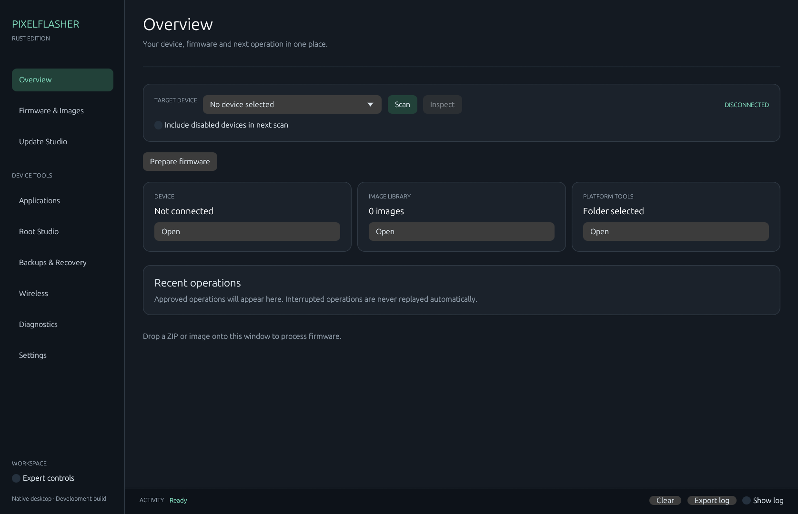

<div align="center">

# PixelFlasher Rust Edition

[](https://www.gnu.org/licenses/agpl-3.0)
[](https://github.com/contactjayclatty/PixelFlasher-Rust-Edition/actions/workflows/ci.yml)
[](https://github.com/contactjayclatty/PixelFlasher-Rust-Edition/releases)
[](https://www.rust-lang.org/)

**The Pixel workstation, rebuilt in native Rust.**

Device in the bar. Firmware in a table. Every write behind a reviewed plan.

[Download v0.3.3](https://github.com/contactjayclatty/PixelFlasher-Rust-Edition/releases/tag/v0.3.3) · [Parity matrix](docs/PARITY.md) · [Changelog](CHANGELOG.md)



</div>

> **Development preview.** This is an independent port of [badabing2005/PixelFlasher](https://github.com/badabing2005/PixelFlasher) at `081286d6` (upstream 10.1.1.1). Parsers, planners, and the desktop UI are tested. Flashing, rooting, and wireless flows have **not** been run on a phone. Read [docs/PARITY.md](docs/PARITY.md) before you point it at a device.

## The window

One shell. Nine places you already know. The device, **Scan**, and **Inspect** stay put while you move.

| | |
|---|---|
|  |  |
| **Firmware & Images.** Pick Factory or Full OTA, choose the model, select one build, then Download. | **Root Studio.** Magisk, KernelSU, KernelSU-Next, SukiSU, Wild_KSU, and APatch. Patch plans stay reviewed. |

## What you get

| | |
|---|---|
| **Native binary** | Rust and egui. No Python runtime, no wxPython, no embedded upstream app. |
| **Reviewed plans** | A mutation is frozen, hashed, and waits for the confirmation phrase. Cancel does not undo a write that already landed. |
| **Firmware library** | Factory ZIPs, OTA payloads, stock and patched images, SHA-256 on the row. |
| **Catalog** | Google factory and full OTA after you accept the terms. Model first, then one row. |
| **Backups** | Partition sets checked against the device hash. Restore plans must match device, build, and slot. |
| **Journals** | Prepared operations are recorded. An interrupted journal is never replayed by itself. |
| **Themes** | Dark and light, mint accent, compact density. |
| **MCP** | Off by default. It can queue a review. It cannot execute, open a shell, or read a secret. |

## Install

Windows x64. Portable ZIP. Nothing to install.

**[Get PixelFlasher-Rust-Edition-0.3.3-windows-x64.zip](https://github.com/contactjayclatty/PixelFlasher-Rust-Edition/releases/tag/v0.3.3)**

1. Download the ZIP and `checksums.sha256`.
2. Check the hash.
3. Extract and run `PixelFlasher.exe`.

`adb`, `fastboot`, and scrcpy are not in the ZIP. In **Settings**, choose the folder that contains both `adb.exe` and `fastboot.exe`.

Your library and settings stay in `%LOCALAPPDATA%\PixelFlasherRust`. Set `PIXELFLASHER_DATA_DIR` when you want a separate workspace.

## First session

1. Open **Settings** and select platform-tools.
2. Connect the phone. **Scan** is the first contact. Startup does not talk to a device.
3. Open **Firmware & Images**. Drop a ZIP, or load the catalog after you accept Google's terms.
4. When a button would change the phone, read the plan. Type the confirmation. Then it runs.

## From the terminal

```powershell
pixelflasher-rust.exe --inspect path\to\init_boot.img
pixelflasher-rust.exe --process path\to\firmware.zip
pixelflasher-rust.exe --library
pixelflasher-rust.exe --import-legacy path\to\PixelFlasher4.db
pixelflasher-rust.exe --catalog factory --acknowledge-google-terms
```

`--import-legacy` only copies files whose SHA-1 still matches. `--catalog` fetches names and checksums. It does not download firmware and it does not flash.

<details>
<summary><strong>Build it yourself</strong></summary>

```powershell
git clone https://github.com/contactjayclatty/PixelFlasher-Rust-Edition.git
cd PixelFlasher-Rust-Edition
cargo run -j 2
```

```powershell
cargo fmt --all --check
cargo test --locked --workspace -j 2
cargo clippy --locked --workspace --all-targets -j 2 -- -D warnings
cargo build --locked --workspace --release -j 2
```

Windows CI runs those checks on every push. Release packaging is in [docs/RELEASING.md](docs/RELEASING.md).

Capture the real window:

```powershell
$env:EFRAME_SCREENSHOT_TO = "screenshot.png"
$env:PIXELFLASHER_CAPTURE_PAGE = "firmware"   # overview, root, apps, backups, …
cargo run --release
```

</details>

<details>
<summary><strong>Map of the repo</strong></summary>

| | |
|---|---|
| [Architecture](docs/ARCHITECTURE.md) | What the core owns, and what the desktop is allowed to do |
| [Parity](docs/PARITY.md) | Implemented, partial, and still missing |
| [Implementation plan](docs/IMPLEMENTATION.md) | The road to 1.0 |
| [Validation](docs/VALIDATION.md) | Tests, smoke checks, and what they do not prove |
| [MCP](docs/MCP.md) | The review-only local server |
| [Contributing](CONTRIBUTING.md) | How to change it |
| [Changelog](CHANGELOG.md) | What each version shipped |
| [Notice](NOTICE.md) | Upstream credit and the license record |

The shared core lives in `crates/core`. The window lives in `src/ui`. MCP lives in `crates/mcp` and is a separate executable.

</details>

## Compared with the original

| | PixelFlasher | Rust Edition |
|---|---|---|
| Runtime | Python and wxPython | One native Windows binary |
| Window | Toolbar and dialogs | Same jobs, left rail, device bar, tables |
| A write to the phone | Runs when you ask | Frozen plan, then your confirmation |
| This release | Upstream 10.1.1.1 | Port in progress. Not a drop-in of every screen. |

## Credit

Independent port of PixelFlasher by [badabing2005](https://github.com/badabing2005/PixelFlasher) and contributors. The Rust app does not start or embed the Python app. Upstream revision `081286d6baf8ac969df29e8b0ab3a5b6ae4cfb54`. License notes are in [NOTICE.md](NOTICE.md).

Pixel is a trademark of Google. This project is not affiliated with Google.

Flashing, rooting, and bootloader changes can wipe a phone or leave it unable to boot. This build is provided as-is. Hardware validation is still pending. Have a recovery path before you try a device operation.

<div align="center">

[Releases](https://github.com/contactjayclatty/PixelFlasher-Rust-Edition/releases) · [Issues](https://github.com/contactjayclatty/PixelFlasher-Rust-Edition/issues) · [Parity](docs/PARITY.md)

</div>
